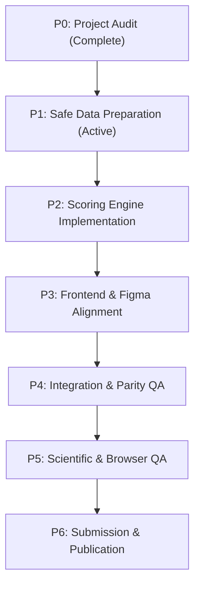

# TerraTwin — Official Space Agency Data Resources Roadmap

**Date Approved:** 2026-11-14  
**Authority:** NASA Space Apps Challenge 2026 Human Team Guidance  
**Policy Status:** Partner Space Agency Resources (CSA, ESA, JAXA) & NASA Portals Approved

---

## 1. Compliance & Disclaimer Statement

> **NASA Space Apps Challenge Policy:**  
> *"NASA does not endorse any non-U.S. Government entity and is not responsible for information contained on non-U.S. Government websites. For non-U.S. Government websites, participants must comply with any data use parameters of that specific website."*

Under official challenge rules, the following designated Space Agency Partner Resources are formally approved for the TerraTwin planetary analog pipeline, resolving the prior provider-policy ambiguity identified in `docs/P0_P6_IMPLEMENTATION_GAP_STATUS.md`.

---

## 2. Approved Space Agency Portals & Resources

### A. NASA Resources (United States)
- **NASA Earthdata Search** ([search.earthdata.nasa.gov](https://search.earthdata.nasa.gov/))  
  *Role:* Primary discovery and access portal for Earth observations (MODIS LST, MODIS NDVI, MAIAC AOD, SRTM elevation, GPM precipitation).
- **NASA Worldview** ([worldview.earthdata.nasa.gov](https://worldview.earthdata.nasa.gov/))  
  *Role:* Visual exploration and temporal monitoring of full-resolution daily NASA satellite imagery.
- **NASA Planetary Data System (PDS)** ([pds.nasa.gov](https://pds.nasa.gov/))  
  *Role:* Curated long-term archive for planetary science data from lunar and Martian orbital, lander, and rover missions (MOLA, TES, CRISM, LOLA, Mini-RF).
- **NASA Lunar Reconnaissance Orbiter (LRO)** ([pds-geosciences.wustl.edu/missions/lro/](https://pds-geosciences.wustl.edu/missions/lro/))  
  *Role:* High-resolution lunar surface measurements from LOLA, LROC, LEND, and Mini-RF instruments.
- **NASA LRO Diviner Lunar Data** ([pds-geosciences.wustl.edu/missions/lro/diviner.htm](https://pds-geosciences.wustl.edu/missions/lro/diviner.htm))  
  *Role:* Calibrated thermal radiometer data mapping lunar surface temperature, diurnal range, polar cold traps, and rock abundance.

### B. Canadian Space Agency (CSA)
- **RADARSAT Constellation Mission (RCM)** ([donnees-data.asc-csa.gc.ca/en/dataset/rcm](https://donnees-data.asc-csa.gc.ca/en/dataset/rcm))  
  *Role:* Advanced C-band Synthetic Aperture Radar (SAR) observations for Earth terrain, surface roughness, permafrost, and environmental monitoring.
- **RADARSAT-1 Open Data Archive** ([donnees-data.asc-csa.gc.ca/en/dataset/radarsat1](https://donnees-data.asc-csa.gc.ca/en/dataset/radarsat1))  
  *Role:* Global historical SAR imagery released under an open data license, operating through clouds and polar night.
- **Synthetic Aperture Radar (SAR) Python Tutorial** ([github.com/asc-csa/Synthetic_Aperture_Radar_Tutorial](https://github.com/asc-csa/Synthetic_Aperture_Radar_Tutorial))  
  *Role:* Practical Python/QGIS workflows for SAR backscatter calibration, surface roughness extraction, and texture metrics.

### C. European Space Agency (ESA)
- **Copernicus Data Space Ecosystem** ([dataspace.copernicus.eu](https://dataspace.copernicus.eu/))  
  *Role:* Free and open access to Sentinel missions (Sentinel-1 SAR, Sentinel-2 Multispectral NDVI, Sentinel-3 SLSTR LST) and Copernicus DEM GLO-30.
- **ESA Open Science Catalog** ([opensciencedata.esa.int](https://opensciencedata.esa.int/))  
  *Role:* Curated geoscience datasets, scientific workflows, and terrestrial analog reference collections.

### D. Japan Aerospace Exploration Agency (JAXA)
- **JAXA G-Portal** ([gportal.jaxa.jp](https://gportal.jaxa.jp/gpr/index/index))  
  *Role:* Earth observation products including global satellite precipitation mapping (GSMaP), snow/ice coverage, and vegetation indices.

---

## 3. Eight-Feature Scientific Mapping

| # | Scientific Feature | Approved Earth Sources | Approved Moon Sources | Approved Mars Sources |
|---|---|---|---|---|
| **1** | **Slope** | Copernicus DEM GLO-30 (ESA) & SRTMGL1 (NASA) | LRO LOLA Polar DTM (NASA PDS) | MOLA MEGDR / HRSC blended DTM (NASA PDS) |
| **2** | **Surface Roughness** | Copernicus DEM 1 km std dev & CSA RADARSAT-1/RCM SAR roughness | LRO LOLA 1 km roughness GDR (NASA PDS) | MOLA Surface Roughness Grid (NASA PDS) |
| **3** | **Temperature Contrast** | MODIS Day/Night LST (MOD11A1 / MYD11A1, NASA) & Sentinel-3 SLSTR (ESA) | LRO Diviner Polar GDR Brightness Temp (NASA PDS) | MGS TES Surface Temp / Mars Climate Database (PDS) |
| **4** | **Dryness / Precipitation**| GPM IMERG Final V07 (NASA) & JAXA GSMaP | Hyper-arid regolith baseline (0 mm rainfall) | Hyper-arid surface baseline (0 mm rainfall) |
| **5** | **Vegetation / Bareness** | MODIS NDVI (MOD13A2, NASA) & Sentinel-2 MSI (ESA) | Barren regolith baseline (0.00 NDVI) | Barren regolith baseline (0.00 NDVI) |
| **6** | **Rock / Mineral Type** | ESA Open Science Geologic Catalogs & USGS/Macrostrat lithology | USGS Unified Lunar Geologic Map & Diviner Rock Abundance (NASA PDS) | CRISM Targeted/Global Mosaics & USGS Mars Geologic Map (NASA PDS) |
| **7** | **Water Ice / Permafrost**| NSIDC/IPA Circum-Arctic Permafrost Map (NASA) | LRO Diviner Cold Traps & LEND Polar Hydrogen (NASA PDS) | Subsurface Water Ice Mapping (SWIM) & SHARAD Radar (NASA PDS) |
| **8** | **Dust & Wind / Aerosol** | MODIS/MAIAC AOD 0.55 µm (MCD19A2, NASA) & Sentinel-5P TROPOMI (ESA) | LADEE Exospheric Dust Context (NASA PDS) | MGS TES Dust Optical Depth (NASA PDS) |

---

## 4. Execution Across Phases P0 to P6

### Next Immediate Deliverables
1. **P1 — Data Integration:** Ingest and catalog official source records matching the schema defined in `data/manifests/official_challenge_resources.json`.
2. **P2 — Scoring Engine Implementation:** Implement dual-engine (TypeScript browser + Python CLI) parity using the parameters codified in `data/input/scoring_policy.pending.json`.
3. **P3 — Frontend Updates:** Surface official partner space agency citations (NASA, CSA, ESA, JAXA) in the UI explorer view and detail tabs.
4. **P4 — Verification & Parity Tests:** Run unit test fixtures across both implementations to guarantee identical numerical outputs.
5. **P6 — GitHub Synchronization:** Keep the remote private repository updated with clear, atomic commits.
